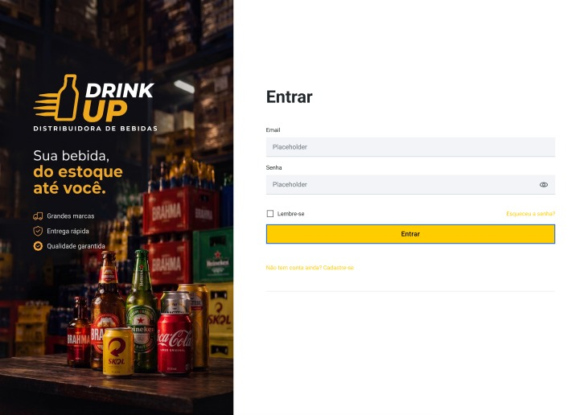
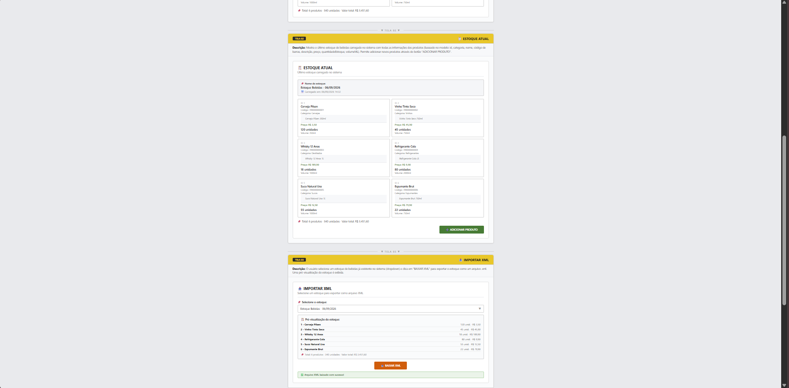
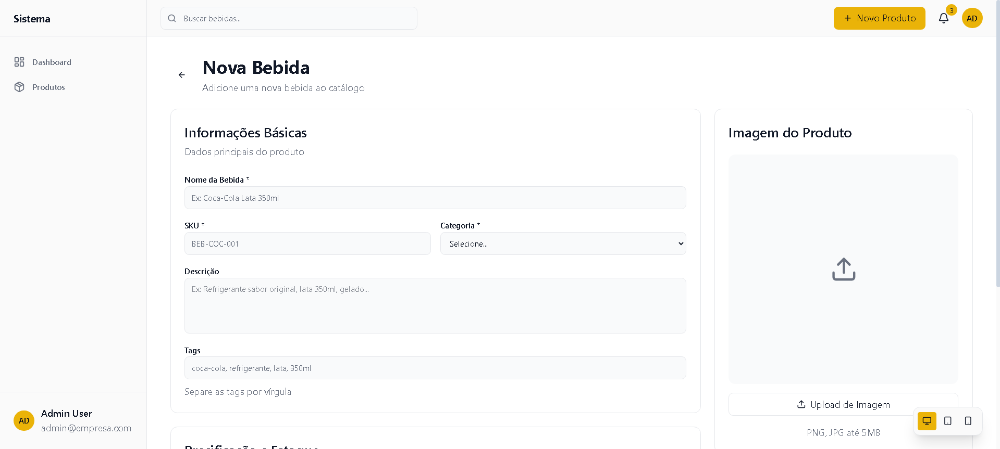
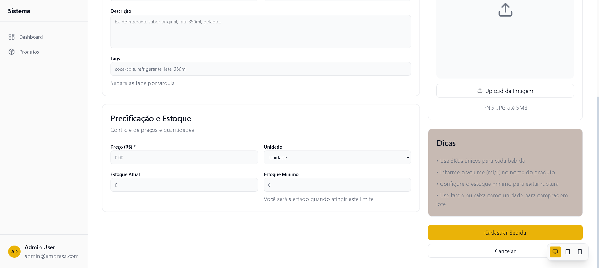
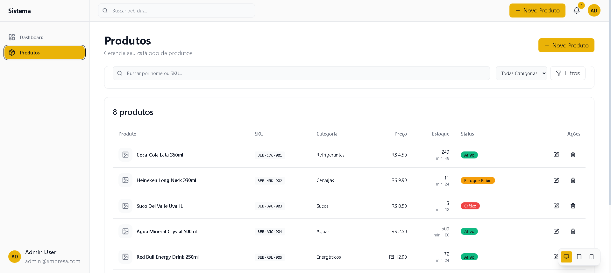
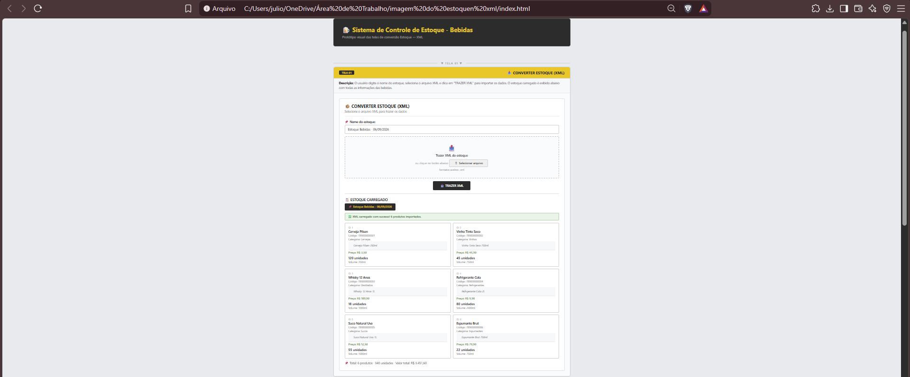
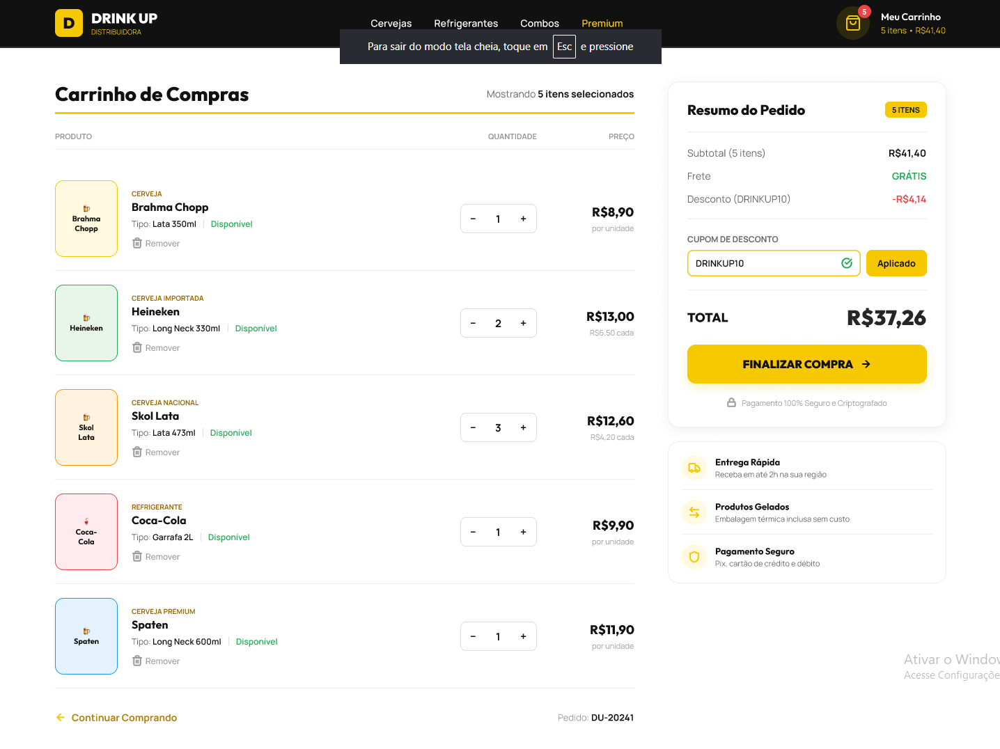

# Loja distribuidora de Bebidas

Este projeto tem como objetivo criar uma loja de bebidas. O usuário poderá
comprar produtos. O administrador poderá converter arquivos XML de estoque,
facilitando a organização e manipulação das informações dos produtos, além 
de retirar itens e verificar o estoque das bebidas.

# Funcionalidades

### Login

### Gerenciamento de Estoque

### Conversão de estoque para XML

### Conversão de XML para Estoque

### Compra de itens

# Programas utilizados

- intelij
- vscode
- git

